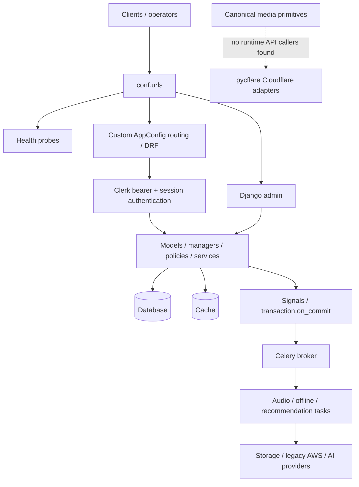

# 90nutmgs / SANFootball current architecture

SF-00 snapshot, 2026-10-11, starting commit `e24ff2e9c9ae7ecb563215f1cfc4f1b6e6687c6e` on `work`. This describes the checked-in application, not a verified production deployment. Findings, concern state and approval belong exclusively in [SANFOOTBALL_IMPLEMENTATION_STATUS.md](../SANFOOTBALL_IMPLEMENTATION_STATUS.md). See the [complete evidence inventory](baseline-inventory.md), [validation results](baseline-validation.md) and [scoped design note](refactor-plan.md).

## Repository and execution boundary

The initial working tree was clean, with one worktree and no untracked user files. The repository has 540 tracked files, including 478 Python files under `app/`. Django registers 67 apps: 48 repository registrations (including API routing configurations) and 19 dependency registrations. There are 88 registered repository models, 49 numbered repository migrations, 174 non-admin URL leaves and 28 `test*.py` modules, including the discovery runner and empty legacy test scaffolds. The inventory also lists abstract model bases and dependency groups.

Python is declared `>=3.14`; the locked SF-00 environment uses Python 3.14.8, Django 5.2.17, DRF 3.18.0, Celery 5.6.3 and `pycflare` 0.0.1 pinned to Git revision `f214c80de3843d47f0593386a60169c77e8bc801`. There are 32 default dependencies; optional `media-workers`, `recommendation-workers` and `dev` extras separate large libraries by installation choice. This does not establish deployed process isolation. No frontend application or client repository is included.

Only SF-00's mapped master sections were read: A.3–A.8; Part I §50 Phase 0, §53, §§67–68; Part II Phase 0 and §68. No additional master section was needed. Older instructions within those sections to load the whole master, repair configuration/CI or add characterization tests are bounded by the explicit SF-00-only instruction and root execution protocol. Existing settings and CI were inspected and executed, not replaced. No domain code, migration, settings, dependency or test changes are part of SF-00.

The master file matches the starting commit byte-for-byte, but its SHA256 differs from the adjacent committed checksum. The checksum also embeds an obsolete absolute package path. This prevents verification against the claimed original package; it does not establish that SF-00 modified the authority. Both files are preserved and the discrepancy is assigned to human review in the ledger.

## Runtime and request flow

`app/manage.py` defaults to `conf.settings.development`. WSGI, ASGI and Celery default to `conf.settings.production`; tests explicitly use `conf.settings.test`. The deprecated `conf.settings` alias activates its development shim only when selected directly. `conf.settings.local` also remains a compatibility shim.

Development defaults to SQLite/locmem; tests use in-memory SQLite, locmem cache, eager Celery, memory broker/results and fake provider adapters. Production requires PostgreSQL, Redis cache/broker URLs, Clerk and Cloudflare configuration. It requires private R2 default FileField storage, distinct public/private buckets and explicit cutover confirmation. Secure cookies, HTTPS/HSTS, host/origin validation and required secrets exist. These checks validate configuration shape, not service reachability or completed data cutover.

The routing chain is `conf.urls → api.config.Api → api.rest.config → web/dashboard AppConfig → app-specific configs`. `core.application.AppConfig` remains a live routing and registration framework. `core.loading` remains used by queue expansion, billing forms, forum managers, compatibility helpers and validators. `api/rest/core.py` is a second loader generation used by comments; `api/rest/utils/loading.py` imports private loader helpers. Podcast app startup also imports dashboard serializers for entitlement representation. SF-04 must characterize these paths before deletion.

## Current owners and unresolved generations

“Canonical candidate” means an existing owner to preserve and verify under the relevant concern. It is not an approved concern or proof of complete target compliance.

| Concept | Current owner and callers | Classification / remaining boundary |
|---|---|---|
| Identity | SDK `users.ClerkUser`; `api/rest/authentication.py`; bearer first, session second; public user serializer allowlist | Existing foundation. `apps/accounts` owns history helpers, not another user table. Full permissions remain SF-05. |
| Access | `memberships/policies.py:AccessPolicy`, structured decisions; `access.py:AccessService` compatibility facade; stream/offline views and episode serializers | Canonical policy candidate. Boolean compatibility caching and signal invalidation remain; all paths are not cache-independent. SF-08. |
| Commercial membership | `memberships/models.py`: Plan, Feature, PlanFeature, Membership, Subscription, Entitlement, AddOn | Transitional: plan price fields, Membership plan ownership, Subscription `active` plus `status`, generic entitlements. Separate Price owner missing. SF-07. |
| Billing | `billing/models.py`: Transaction, Source, SourceType, Bankcard; admin; locking ledger/transition methods | Legacy ledger with tested transitions/card obfuscation; no routed payment provider/webhook lifecycle found. Dormant entitlement helpers refer to absent fields. SF-09. |
| Content | `posts/podcasts/models.py`: Podcast → Season → Episode; selectors in `queries.py`; compatibility services used by dashboard serializers/admin | Canonical root/season owner partly implemented. Child Podcast/parent/structure and old release/exclusive/category-plan projections remain transitional. SF-06. |
| Sports | Region/Country, League/Campaign, Team/Stadium, Person/Player/Staff, Contract/transfers, Match/events, tactics; dashboard and admin writers | Existing app owners. Content taxonomy links are inherited from AbstractAnalytics. Experimental Goal scorer/lineup alternatives and save receivers need characterization. SF-06. |
| Playback | `posts/podcasts/models.py:PlayBack` and manager; podcast web views/serializers; recommendation invalidation receiver | Current mutable owner. Authenticated `(user, episode)` uniqueness, bounds and existing-row locking exist. Anonymous identity uses IP; new-row concurrency remains unproven. SF-10. |
| Queue | `queue/models.py:Queue/QueueItem`; request helper; explicit list/add/clear/remove routes; Django login merge receiver | Transitional single implementation with both `position` and `order`; no unique active queue or ordering-position constraint. SF-11. |
| Library | `media/models.py:PlayList/PlaylistItem`; profile API; content `AbstractAnalytics.subscribers` for free follows | Split ownership; free follows must remain distinct from paid Subscription. No bookmark model found. Routed playlist query refers to missing `image` relation. SF-12. |
| Media identity | `media/canonical.py:MediaAsset/MediaLocation/MediaVariant`, imported by media models; migration 0002 | Canonical candidate with UUID IDs, provider locations, uniqueness and primary-location constraints. Legacy Audio/Image/Video rows remain. SF-13. |
| Media transfer/delivery | `upload_intents.py`, `upload_finalization.py`, `delivery_service.py`, provider contracts and Cloudflare adapters | Existing tested primitives, no non-test runtime API callers found. Actual endpoints still use legacy media/storage. SF-13/SF-14. |
| AI/transcripts | `media/transcription`, chapters, podcast Summary; audio task orchestrates processing | Existing workers and records, with retry/billing/state weaknesses; no verified complete canonical pipeline. SF-15. |
| Community | Routed generic `comments.Comment`; separate forum Discussion/Reply and admin | Comments current routed owner, forum legacy generation. Target access/publication/parent checks and moderation are incomplete. SF-16. |
| Analytics/history | `analytics.ObjectView`, counters, cookie `UserHistoryManager`, playback-derived trends | Different purposes but no canonical durable event publication/outbox owner. Optional dormant `core/events` is not an operating event bus. SF-17. |
| Discovery/search | ExploreAPIView → podcast selectors/personalized queries; DRF search filters | Current public query owner. Dedicated search/index owner missing; query bounds do not bound all scoring work. SF-18. |
| Recommendation generations | Podcast queries; `recommendation/services`; affinity table/task; `recommendation/ml`; `posts/recommender`; `core/recommender/datasets` | Unresolved generations. Dataset builder has command caller; no runtime caller found for ANN recommendation or separate service queries outside their package. SF-18. |
| Editorial | `promotions` remote Image/Giffy state and callbacks, MultiImage, handpicked/automatic/ordered lists; dashboard/public views | Active remote-banner path plus older editorial models. Upload bytes and callbacks need provider/concurrency review. SF-18. |
| Offline | `media/offline`: Package, License, Device, Packaging; web/offline routes and tasks | Legacy custom KMS/encryption path, disabled by default with tested gates. No new download owner introduced. SF-19. |

## API and operator compatibility

All resolved leaf routes, callback classes and explicit ViewSet action mappings appear in [baseline-inventory.md](baseline-inventory.md). Important surfaces are:

| Surface | Existing behavior / caller boundary |
|---|---|
| `/health/live/`, `/health/ready/` | Process liveness and database/cache round-trip; readiness returns 503 without error detail. Liveness body currently identifies `90Nutmegs`; one legacy assertion expects `sanfootball`. |
| `/admin/` | Repository models registered by their admin modules plus package registrations; admin map is in inventory. |
| `/api/rest/web/explore/` | Podcast discovery/selectors/recommendations. |
| `/api/rest/web/apps/podcast/…` | Podcast/episode detail, playback progress and promotions. Publication selectors, legacy season mapping and access-aware serialization already exist. |
| `/api/rest/web/apps/profile/…` | Free follows, followed podcasts and playlist CRUD/item/reorder actions. |
| `/api/rest/web/apps/queue/…` | Explicit queue routes, not unrestricted ModelViewSet CRUD. |
| `/api/rest/web/apps/media/…` | Streaming, audio and feature-gated offline functions. Signing tests do not prove Cloudflare primitive integration. |
| `/api/rest/web/apps/comment/create/` | Authenticated generic comment creation without full resource policy enforcement. |
| `/api/rest/dashboard/apps/…` | Staff/model-permission administration of persons, matches, podcasts, promotions, regions and memberships; serializers bridge legacy content/access fields. |
| `/api/rest/dashboard/schema/`, Swagger and ReDoc | OpenAPI generation succeeds with 84 warnings (45 unique); warnings include ambiguous components, parameter/type inference and operation IDs. |

There is no tracked frontend to confirm client usage. Public identifiers, routes, admin flows and old projections must therefore be treated as compatibility obligations until caller/data review. No API or client behavior changes in SF-00.

## Data and migration boundaries

The full migration graph resolves and no model/migration drift is detected. The suite builds disposable SQLite schemas and includes historical migration tests. This does not reveal which migrations are applied in a deployed database or establish PostgreSQL locking/SQL behavior.

- Podcast 0002 deterministically backfills publication/access; its reverse data operation is a noop. Undated content fails closed. Podcast 0003 introduces Season, repairs duplicate slugs deterministically and maps child-Podcast episodes to roots; reverse restores child ownership, but does not restore original repaired slug values. Reverse/reapply, collisions and invalid graph cases have existing tests.
- Media 0002 introduces canonical asset/location/variant tables with DB constraints. Existing unit tests cover ownership, uniqueness and capability binding; no object reconciliation/cutover evidence exists.
- Comment/reaction/thumbnail/analytics generic object IDs were widened to strings, with indexes where defined. Generic targets remain unenforced by foreign keys. PostgreSQL affinity SQL still joins a UUID podcast key directly to a text ObjectView ID and needs later validation.
- Queue has owner-or-session and `(queue, track)` invariants, but not one active queue per principal or unique position. PlayBack, PlaylistItem, Entitlement and PlanFeature have their existing uniqueness rules; the model inventory records exact definitions.
- Promotions 0002 backfills remote-banner fields and removes the old image field with noop data reverse; persons 0002 removes/renames historical fields. These historical operations must not be treated as losslessly reversible without data review.

No new migrations/backfills are created or applied to a persistent database. No historical migration is edited.

## Tasks, events and signals

Celery imports register six repository tasks. Runtime registration was probed without dispatching jobs:

| Task | Callers / effects |
|---|---|
| `Audio Processing Pipeline` | Audio post-save → `helpers.tasks.delay_on_commit`; storage copy/FFmpeg, HLS/preview, transcript/chapters/summary. |
| `CloudFront Audio HLS Signing Task` | Rotation management command; HLS cookie cache warmup. |
| `Recalculate Trending Episodes` | Management command; playback aggregation and episode score updates. |
| `apps.recommendation.tasks.recalc_user_category_affinity_postgres` | Beat and management command; PostgreSQL temporary-table aggregation/upsert. |
| `apps.media.offline.tasks.build_offline_package_streaming` | Offline package task; feature-gated KMS/S3 packaging. |
| `apps.media.offline.tasks.build_offline_package_task` | Offline API job; package/status/callback/optional Channels delivery. |

Four beat entries name the unregistered Celery task `django.core.management.call_command`. Two also reference nonexistent command names (`revoke_inactive_devices`, `gc_orphan_packages`); tracked equivalents have different names. The affinity schedule label says ten minutes but its interval is one day. Celery timezone is Australia/Tasmania while Django uses UTC. Task hard limit is 30 minutes; broker defaults to Redis and results to `django-db`. No worker queue routing, concurrency/prefetch budget or deployed worker definition is established.

Active app-ready imports connect user creation to media settings/quota, audio creation to post-commit task publication, image creation to synchronous thumbnails, playback to recommendation invalidation, entitlement/subscription mutations to access/recommendation invalidation, podcast-view events to cookie history, Django login to queue merge, sports saves to code/Fitness creation and lineup M2M to position validation. Some cache invalidation handlers broadly suppress failures.

`apps/match/signals.py` defines Match event/possession creation but is not imported by its AppConfig or another observed caller. Custom account login/registration signals are defined without callers. `core/events` contains dormant QuixStreams/Kafka/thread code; no caller or declared `quixstreams` dependency establishes a live event bus. Post-commit task publication is useful existing behavior but is not durable outbox delivery.

Audio tasks use broad retry and late acknowledgement; storage overwrites and transcription charging lack a durable attempt identity. Transcription failure can be caught while Audio becomes processed. Quota charging uses an unlocked read/modify/write; duplicate processing can charge repeatedly. R2 finalization reserves a pending destination before external promotion; interrupted promotion needs recovery design. These are later-concern findings, not exercised production incidents.

## Infrastructure and operational evidence

| Area | Checked-in evidence | Unknowns / risk |
|---|---|---|
| Compute / hosting | Django WSGI/ASGI/Celery entrypoints; no Docker/Compose/Procfile/deployment manifests found | Vendor, regions, web server, replicas, worker isolation and rollback topology unknown. |
| Database | Required production PostgreSQL, default connection age 60s and health checks | Live version, TLS/private access, connection budget, pool/PgBouncer, replicas and backups unknown. |
| Cache / broker | Separate configurable Redis cache/broker URLs; DB Celery results | Physical isolation, capacity, connection caps, persistence, failover and dead-letter/retry operations unknown. |
| Storage / CDN | Cloudflare R2/Images/Stream adapters through pycflare; private production R2 FileFields; legacy boto3/S3/CloudFront retained | Actual object migration, bucket lifecycle/IAM, CDN/edge policy, data reconciliation and provider usage unknown. |
| Local files | Audio processing uses cleaned temporary directories; image thumbnail and metadata helpers use `.path`/MEDIA_ROOT; recommender artifacts under `WORKSPACE_ROOT/shared/recommender` | Image path assumes local filesystem and conflicts with remote R2; artifact distribution/durability unspecified. |
| Upload / delivery | Tested direct-upload/finalization/delivery primitives; live legacy routes; synchronous Giffy banner byte submission | No routed complete direct-upload path identified. Large-request and interrupted-promotion behavior need owner review. |
| Security / secrets | `.env.example` placeholders; production config validation; Clerk; storage/stream signing; offline callback origin checks and disabled feature gate | No real credential bindings in this environment. Trusted proxy stripping, secret rotation, IAM/private networking and historical secret exposure unverified. Dependency audit has failures. |
| Observability | Health probes, regular logging, four transcription Prometheus metrics, DB task results | No metrics scrape route/config, alert definitions, tracing, structured log policy, SLOs or runbooks found. Probes omit broker/worker/provider health. |
| Backup / DR | No tracked backup scripts, restore exercises or DR runbooks | RPO/RTO, retention, recovery roles and restoration success unknown; absence from source does not prove absent deployed backups. |
| CI / releases | Backend workflow with locked install, lint/type/check/migration/schema/audit/test/coverage gates | Current baseline fails format, one test and dependency audit. No deployment promotion, image release, environment or IaC pipeline found. |
| Cost / capacity | Audio variants/HLS/preview copies, FFmpeg/temp disk, external AI calls, AWS/KMS plus Cloudflare, recommender artifacts, analytics/task/license storage growth | No bill, quota, retention threshold, load benchmark, storage accounting or worker saturation evidence. |

## Verification limits

Baseline checks are detailed in [baseline-validation.md](baseline-validation.md). Existing tests verify specific behavior; they do not approve SF-01/SF-02 or later concerns. Comments/forum scaffolds, playlist target behavior, PostgreSQL-only queries/concurrency, real provider contracts, asynchronous queues, migrations against live volumes, backups and full client journeys remain incomplete or unverified. No performance claim is made from the SQLite suite.

SF-00 changes have no query, concurrency, entitlement, privacy, provider, storage or runtime impact. The observed risks are preserved in the ledger for staged review; no superseded implementation has been removed.
